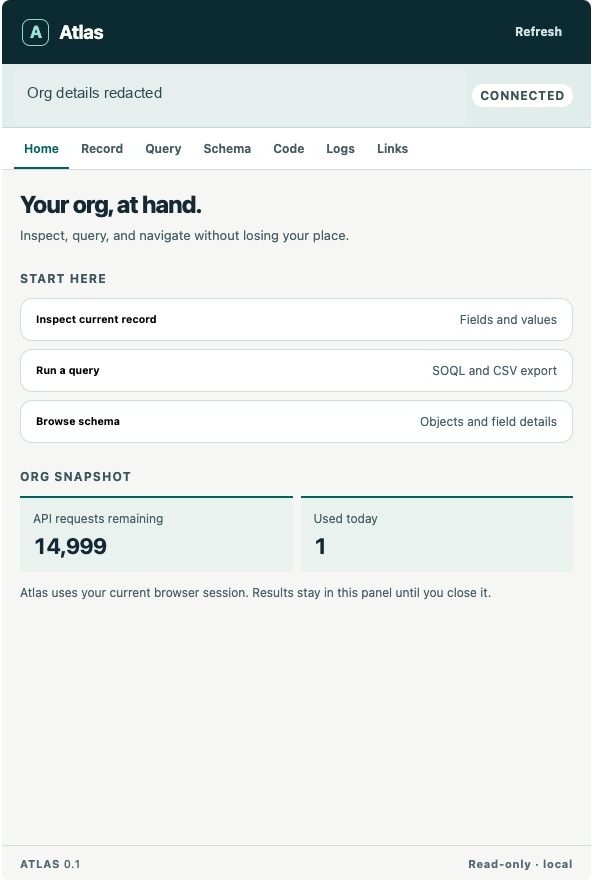
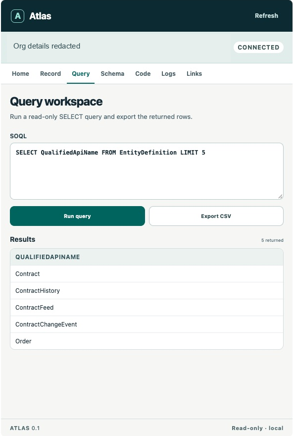
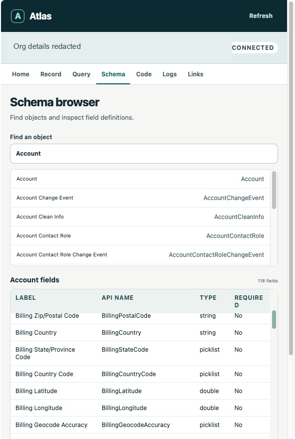
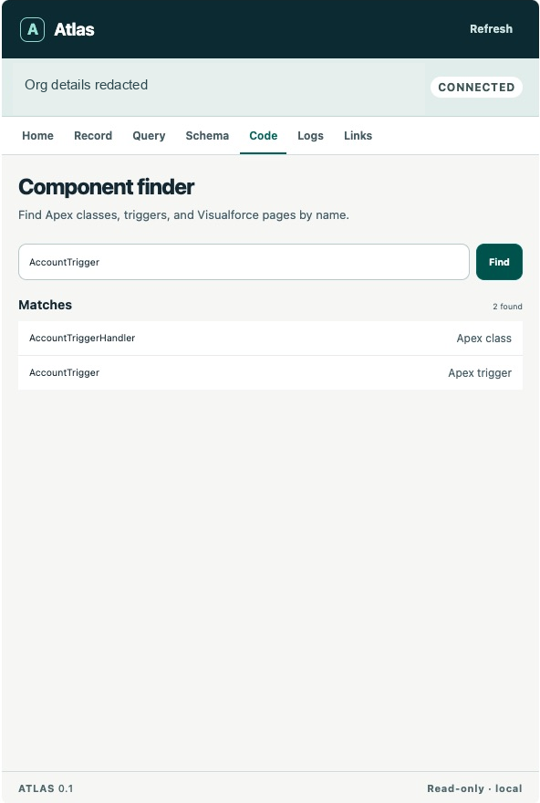
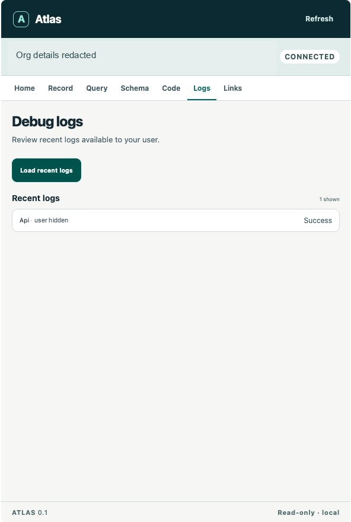
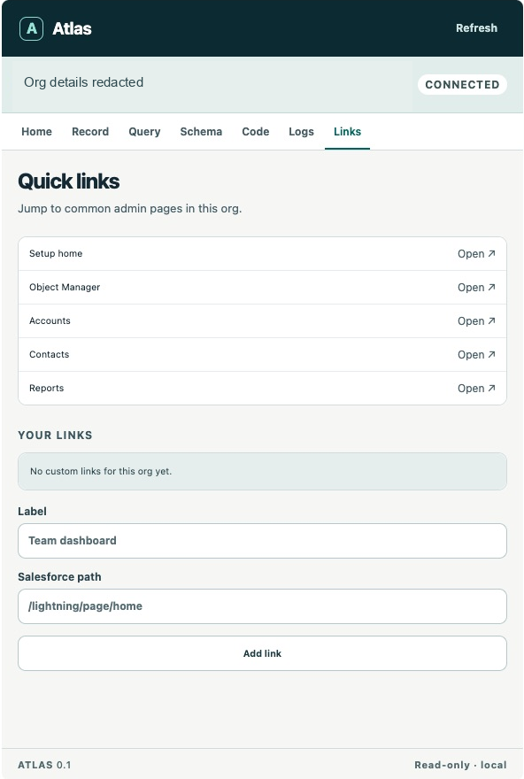

# Atlas for Salesforce

A small, original, open-source Salesforce workspace for Chrome. Atlas puts record inspection, object and field browsing, read-only SOQL, CSV export, quick links, Apex component lookup, and recent debug logs in one side panel. It runs entirely in your browser and has no backend or telemetry.

Atlas is an independent community project. It is not affiliated with Salesforce or the extensions studied in [the research notes](docs/RESEARCH.md).

## Screenshots

Captured from the extension running in Chrome against a Salesforce Developer Edition org. The org address is redacted; the query shows metadata rather than customer records.

| Home | Query results |
| --- | --- |
|  |  |

| Schema browser | Component finder |
| --- | --- |
|  |  |

| Debug logs | Quick links |
| --- | --- |
|  |  |

Also see the [query workspace](screenshots/query-workspace.png). See [live test notes](docs/LIVE_TEST.md) for what was verified.

## Install locally

Atlas is **not listed in the Chrome Web Store**. Install it as an unpacked extension from this source:

1. Clone this repository, or use GitHub's **Code → Download ZIP** and extract it. Keep the extracted folder on your computer; Chrome loads files from that folder.
2. In Chrome 116 or later, open `chrome://extensions` and enable **Developer mode**.
3. Choose **Load unpacked** and select this folder (the folder containing `manifest.json`).
4. Review Chrome's permission prompt. Atlas needs access to Salesforce tabs and their session cookie for direct API calls; details are below.
5. Sign in to a Salesforce org, open an org tab, and click the Atlas extension button (pin it from Chrome's puzzle menu if needed). Chrome opens the side panel. The org strip should say **Connected**.

No build, npm install, Salesforce Connected App, or external service is required for an unpacked installation. A release ZIP can be made with `npm run package` and unpacked into a folder before using **Load unpacked**.

## How to use it

The screenshots above show the main workflow:

1. **Home:** confirm the active org is connected. The API limit numbers are a snapshot from the last panel refresh.
2. **Record:** open a Salesforce Lightning record page and select **Record**. Atlas fills in its object and record ID and shows accessible fields and values. You can also enter a different object API name and record ID.
3. **Query:** enter one read-only `SELECT` SOQL query and select **Run query**. The table previews the first 100 returned rows; **Export CSV** saves all returned rows, up to the stated 10,000-row cap. The [query screenshot](screenshots/query-results.png) uses metadata only.
4. **Schema:** search an object name, then select it to see field labels, API names, types, and required status. The [schema screenshot](screenshots/schema-browser.png) shows Account.
5. **Code:** search a component name. Atlas looks for matching Apex classes, triggers, and Visualforce pages. Click a result to copy its ID. The [component screenshot](screenshots/component-finder.png) shows two matches that existed in the test org.
6. **Logs:** select **Load recent logs**, then choose one to read or download. The [log screenshot](screenshots/debug-logs.png) shows a successful test log with the user name hidden.
7. **Links:** open common Salesforce destinations or save your own org-specific relative path. The [links screenshot](screenshots/quick-links.png) shows the controls.

## What works

| Tool | First release behavior |
| --- | --- |
| Org context | Detects common production and sandbox Lightning org hosts; marks each org's tab with a deterministic colored Atlas favicon. |
| Record inspector | Recognizes a Lightning record URL or accepts an object API name and record ID; shows accessible field labels, API names, types, and values. |
| Query workspace | Runs one read-only `SELECT` SOQL query, follows Salesforce pagination up to 10,000 rows, previews 100 rows, and exports returned rows to CSV. Partial exports are labeled. Spreadsheet formula injection is escaped. |
| Schema browser | Lists accessible objects and their field definitions. |
| Component finder | Searches Apex class, Apex trigger, and Visualforce page **names** through the Tooling API; click a result to copy its ID. This does not search source bodies. |
| Debug logs | Lists the 30 most recent accessible logs, displays a log body, and downloads it. |
| Quick links | Opens standard Salesforce destinations and saves custom relative paths per org host in local Chrome storage. |
| Org snapshot | Shows API request limits when the Salesforce Limits resource is available. |

All Salesforce API operations in this release are GET requests. Atlas does not edit, delete, deploy, execute Apex, store passwords, or store the `sid` session cookie. Query and record results remain in the side panel's memory until it closes. Custom quick links are the only user data saved by Atlas.

## Permissions and technical limits

| Permission | Why it is needed |
| --- | --- |
| `cookies` | Reads the `sid` cookie for the active Salesforce tab to authorize direct Salesforce API calls. The token is used in the extension service worker and is never saved or sent to the panel. |
| `tabs` | Finds the active org tab and its URL, detects tab changes, and opens quick links. |
| `storage` | Saves custom links per org host. |
| `sidePanel` | Shows the workspace beside Salesforce. |
| Salesforce/Force host access | Allows the service worker to call Salesforce REST/Tooling APIs and the content script to mark org tabs. This is broad access across those domain families and will produce a Chrome permission warning. |

Supported hosts are common `*.my.salesforce.com`, `*.salesforce.com`, and `*.lightning.force.com` URLs over HTTPS. Custom domains, Government Cloud, Experience Cloud, legacy Visualforce domains, unusual sandbox routing, and orgs that do not expose a usable `sid` cookie may need further implementation. Some Salesforce policies disallow API use from the browser session; Atlas then shows the API error. The connected user needs API Enabled and access to each object, field, log, and Tooling API resource. Salesforce API limits apply. Queries are capped at 10,000 returned rows and 20 pages to protect the browser from unbounded exports; use Salesforce Bulk API or another approved tool for large exports.

The favicon is an original Atlas mark and can be replaced by Salesforce during page navigation; the content script reapplies it while the tab is open. It does not change Salesforce data. Because it observes the tab's document head, admins who prefer no page change can remove the `content_scripts` entry from the manifest; all side panel tools continue to work.

## Development

Requires Node 20+ only for tests and packaging:

```sh
npm test
npm run check
npm run package
```

Source is plain ES modules. `src/background.js` owns Salesforce session access and API requests; `src/core/` contains pure validation and CSV functions; `src/ui/` is the side panel; `src/content/` marks org tabs. There are no third-party runtime dependencies and no remotely hosted scripts.

Tests cover host mapping, validation, query cursor boundaries, CSV escaping, and deterministic org color. A limited live smoke test is documented in [docs/LIVE_TEST.md](docs/LIVE_TEST.md). To verify against your org, use a low privilege test user and check: connection state, record inspection, schema, a small `SELECT Id, Name FROM Account LIMIT 10` query, CSV output, component name lookup, and recent logs if available.

## Roadmap

The [feature map](docs/RESEARCH.md) identifies features studied and the honest first-release scope. Likely next steps: custom domain mapping, source body search with bounded indexing, query history, field filtering, richer log analysis, and optional OAuth with PKCE. Any write operation would need a separate design and explicit confirmation in the UI.

## License

MIT. See [LICENSE](LICENSE).
